# Меню Temple

Источник: https://yandex.ru/maps/org/temple/43794175271/menu/

Пометка источника: «Давно не обновлялось».

Привязки выполнены вручную: source_label — название написано на изображении; visual_match — сопоставление по видимому составу, не подтверждённая Яндексом связь. candidate_images — неоднозначные варианты. Пути относительно assets/; общие кадры и добавки описаны в evidence.

## Без категории

### Сырники — 450 ₽

menu-001

Порция: 3 шт.

соус: сметана, клубничный/апельсиновый джем

Фото: food/food-029.jpg (visual_match)

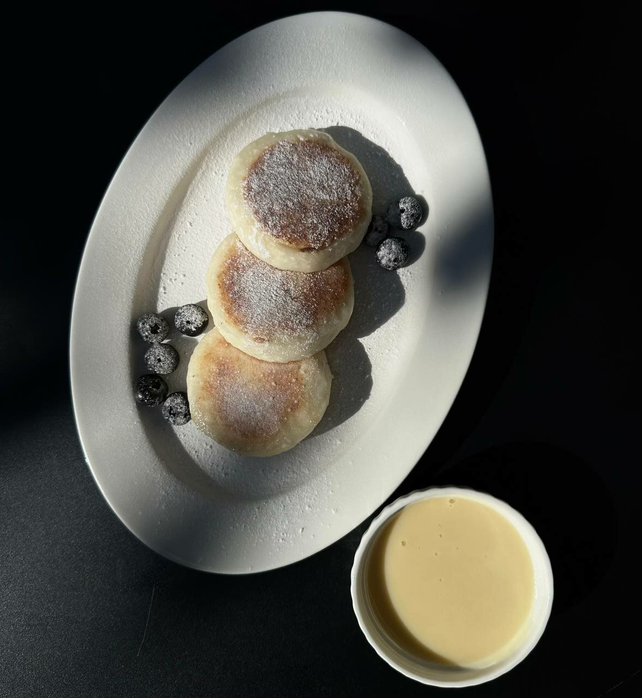

### Альтернативное молоко — 100 ₽

menu-002

50/70/90

Однозначное фото не найдено.

### Дрип — 130 ₽

menu-003

Порция: 1 шт.

Однозначное фото не найдено.

### Чизбургер — 390 ₽

menu-004

булочка/ мясная котлета/ маринованные огурчики/ чеддер плавленый/ лук/ кетчуп/ горчичный соус

Фото: food/food-004.jpg (visual_match)

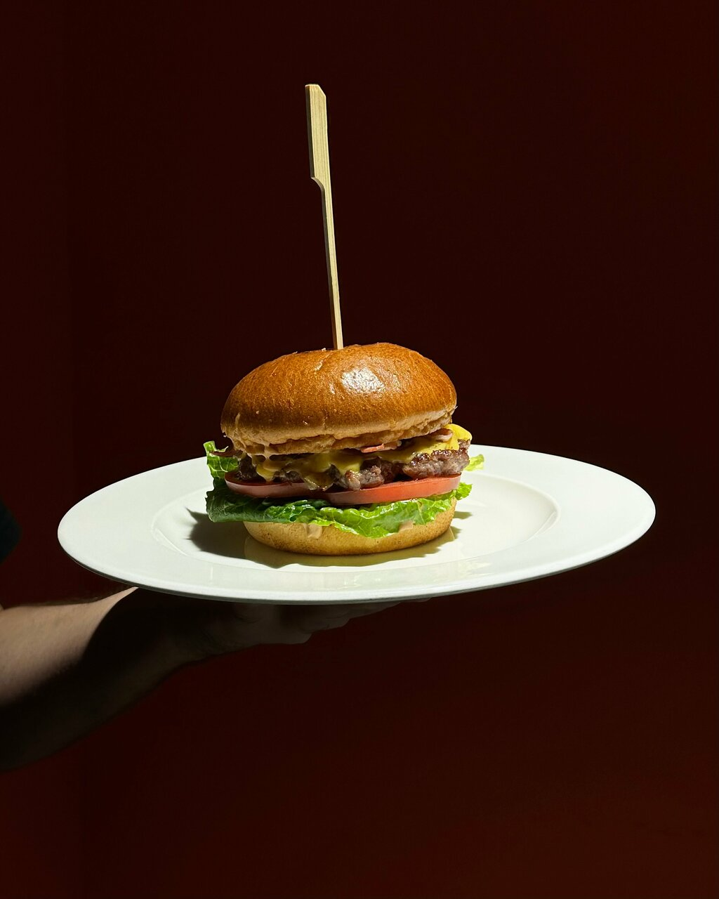

### Цикорий — 230 ₽

menu-005

Порция: 200 мл

Однозначное фото не найдено.

### Рисовая каша — 340 ₽

menu-006

подается с апельсиновым джемом

Однозначное фото не найдено.

### Зеленая гречка с яйцами пашот — 390 ₽

menu-007

зеленая гречка, 2 пашот, огурец, пармезан

Фото: menu/menu-photo-01.jpg (source_label)

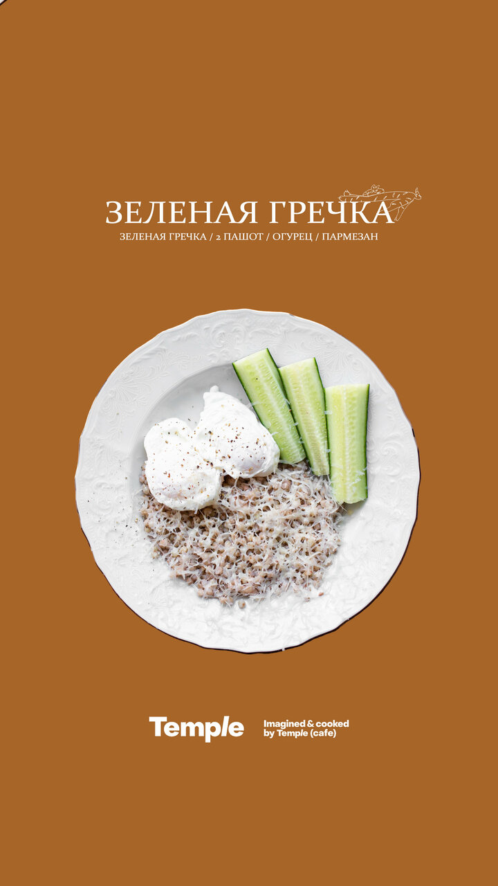

## Салаты

### Салат с креветками — 720 ₽

menu-008

зелень, руккола, креветки, черри, кунжутно-ореховый соус, кунжут

Фото: food/food-007.jpg (visual_match)

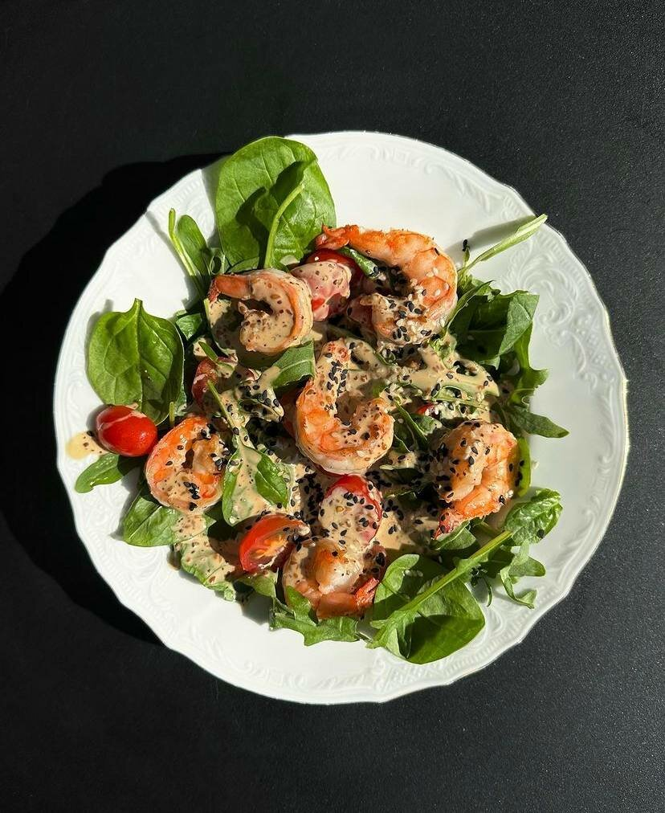

### Зелёный салат — 580 ₽

menu-009

брокколи, огурец, цукини, авокадо, микс зелени, соус, злаки

Однозначное фото не найдено.

### Листья салата с соусом цезарь с креветками — 750 ₽

menu-010

креветки, романо, цезарь, черри, пармезан, чипсы из багета

Однозначное фото не найдено.

### Листья салата с соусом цезарь с курицей — 580 ₽

menu-011

курица, романо, цезарь, черри, пармезан, чипсы из багета

Однозначное фото не найдено.

## Десерты

### Банановый брауни — 390 ₽

menu-012

Однозначное фото не найдено.

### Картошка — 280 ₽

menu-013

Однозначное фото не найдено.

### Трубочка со сгущенкой — 260 ₽

menu-014

Фото: food/food-040.jpg (visual_match)

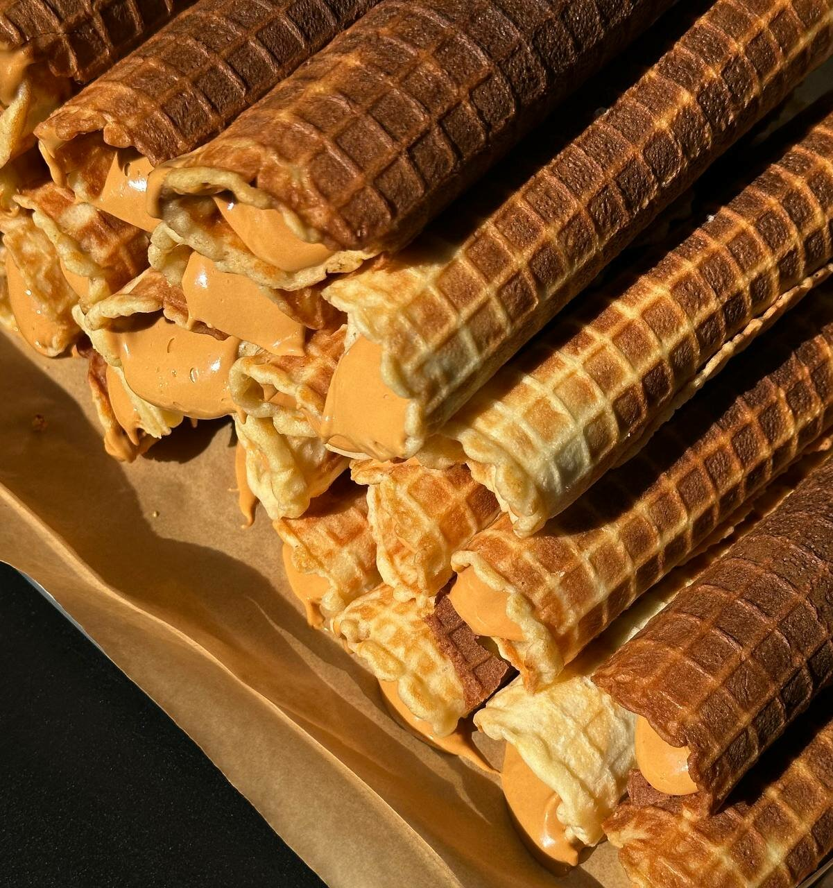

### Чизкейк классический — 370 ₽

menu-015

Однозначное фото не найдено.

Неоднозначные кандидаты: food/food-028.jpg

### Брауни — 390 ₽

menu-016

Однозначное фото не найдено.

### Канеле — 240 ₽

menu-017

Порция: 1 шт.

Однозначное фото не найдено.

### Конфета — 70 ₽

menu-018

Однозначное фото не найдено.

### Френч-тосты — 370 ₽

menu-019

тосты-бриошь с кленовым сиропом

Однозначное фото не найдено.

## Чай

### Чай листовой — 280 ₽

menu-020

ассам,
эрл грей,
чёрная смородина,
сенча,
молочный улун,
успокаивающий,
травяной

Однозначное фото не найдено.

Неоднозначные кандидаты: food/food-011.jpg

### Чай составной — 390 ₽

menu-021

облепиха,малина

Однозначное фото не найдено.

Неоднозначные кандидаты: food/food-011.jpg

### Чай гречишный — 320 ₽

menu-022

Однозначное фото не найдено.

Неоднозначные кандидаты: food/food-011.jpg

## Сэндвичи

### Сэндвич с беконом — 680 ₽

menu-023

чиабатта, бекон, груша, сливочный сыр, зелень, вяленые томаты, бальзамик, кунжут

Однозначное фото не найдено.

Неоднозначные кандидаты: food/food-030.jpg

### Сэндвич с лососем — 850 ₽

menu-024

черный хлеб, сливочный сыр, авокадо, с/с лосось, яйцо пашот, голландез

Фото: food/food-008.jpg (visual_match)

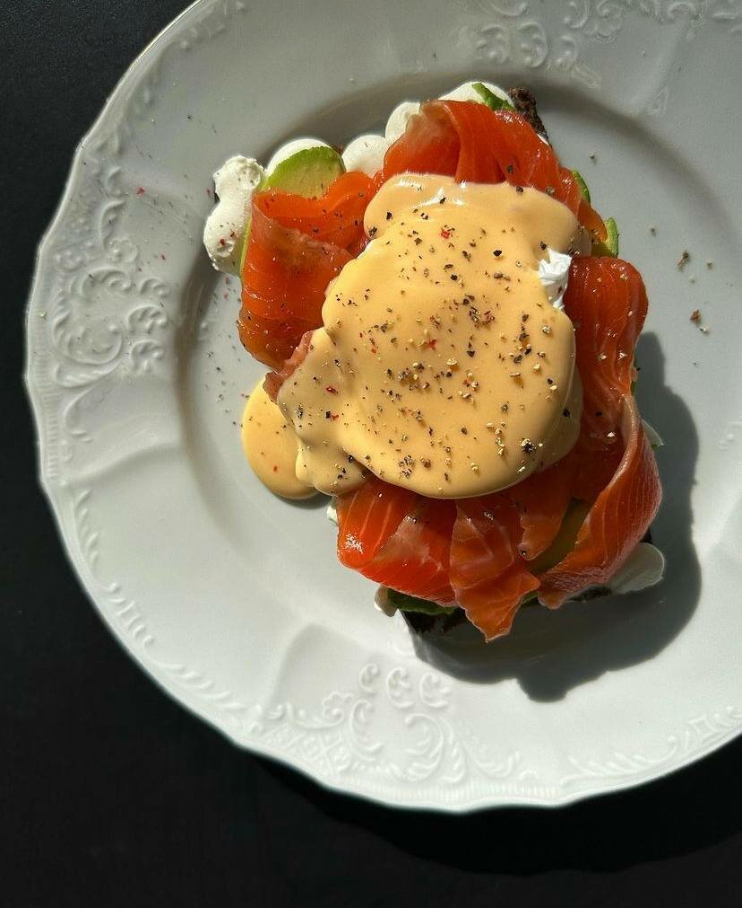

Неоднозначные кандидаты: food/food-024.jpg, food/food-027.jpg, food/food-028.jpg, food/food-049.jpg

### BLT — 620 ₽

menu-025

чиабатта/бриошь, бекон, салат, майонез, томат, лук, чеддер, шрирача, кленовый сироп

Фото: food/food-034.jpg (visual_match)

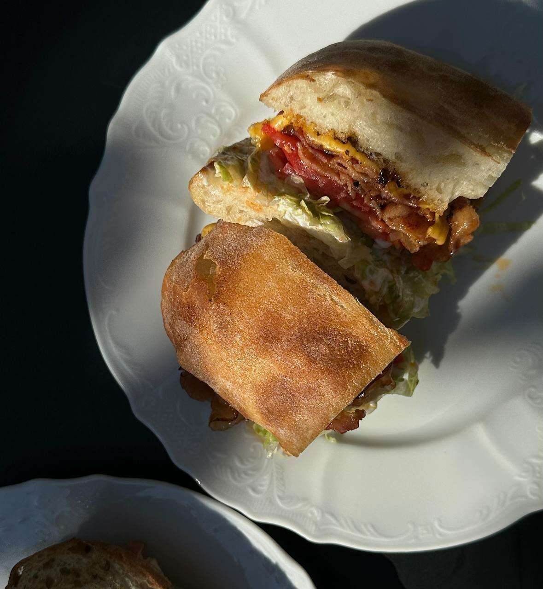

Неоднозначные кандидаты: food/food-030.jpg

### Бриошь с лососем — 850 ₽

menu-026

бриошь, пюре из авокадо, с/с лосось, пашот, голландез

Однозначное фото не найдено.

Неоднозначные кандидаты: food/food-024.jpg, food/food-027.jpg, food/food-028.jpg, food/food-049.jpg

### Авокадо тост — 350 ₽

menu-027

цельнозерновой хлеб, авокадо 1/2, оливковое масло

Однозначное фото не найдено.

Неоднозначные кандидаты: food/food-010.jpg, food/food-041.jpg

### Гриль-чиз — 650 ₽

menu-028

зерновой хлеб, сливочное масло, чеддер, голландский сыр, моцарелла, трюфельное масло, томатный конфитюр

+ бекон - 100р

Однозначное фото не найдено.

### Сэндвич с тунцом — 650 ₽

menu-029

зерновой хлеб, тунец, яйцо, майонез, свежий огурец, маринованный красный лук

Фото: food/food-038.jpg (visual_match)

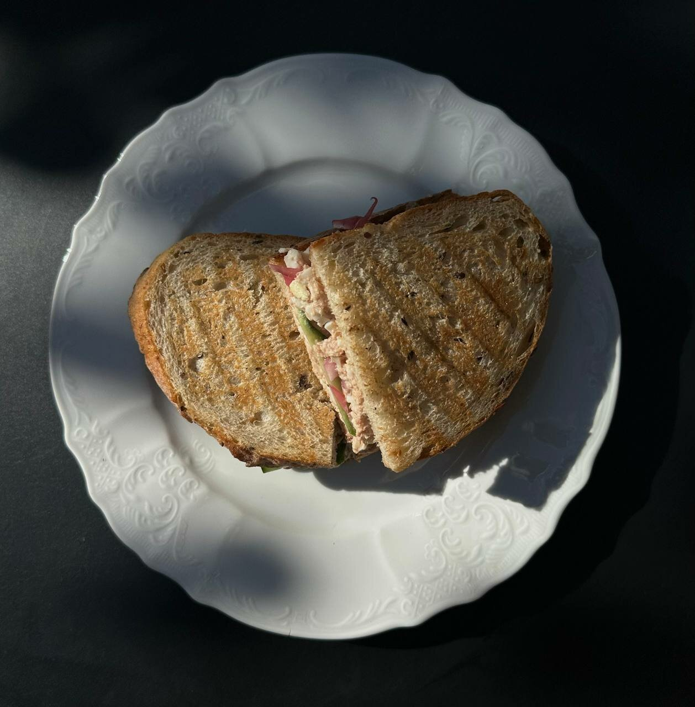

### Сэндвич с говядиной — 640 ₽

menu-030

бриошь, котлета из говядины, помидор, маринованные огурцы, чеддер, майонез,
соус барбекю, зелень

Фото: food/food-036.jpg (visual_match)

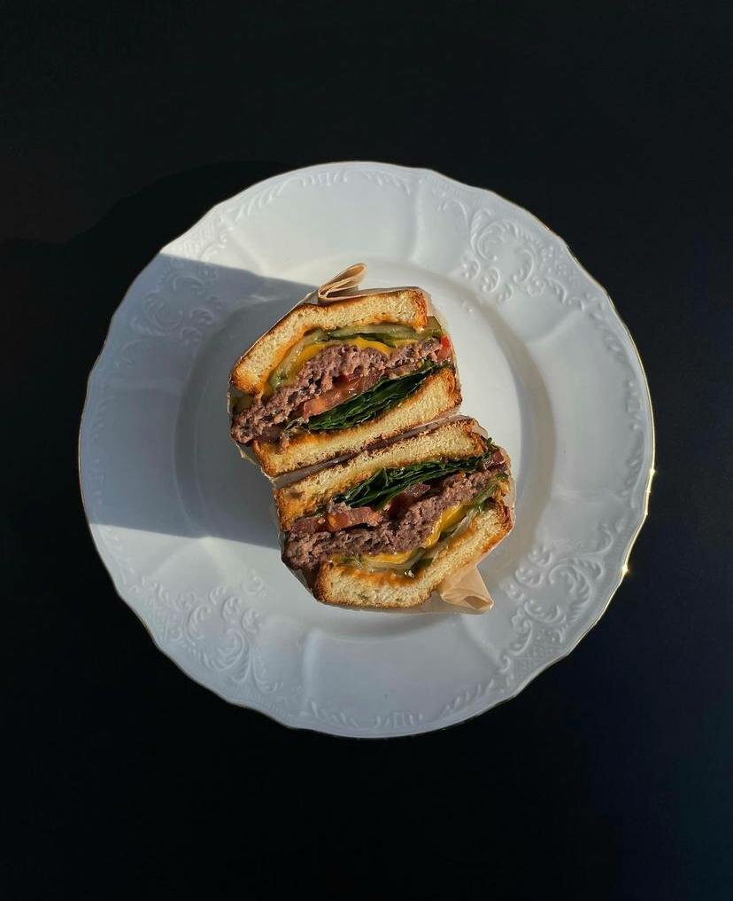

### Сэндвич с креветкой — 750 ₽

menu-031

бриошь, креветки, помидор, маринованный лук, коктейльный соус, зелень

Фото: food/food-039.jpg (visual_match)

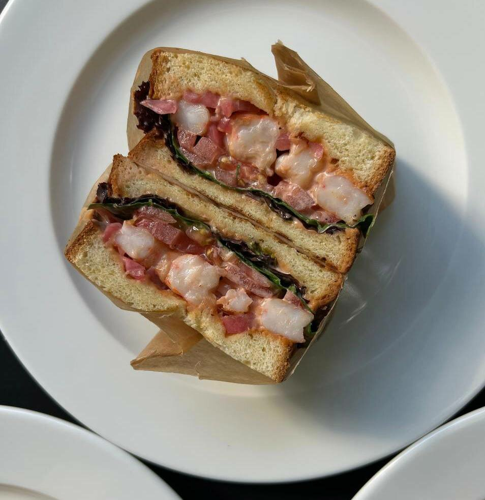

## Завтрак

### Скрембл — 400 ₽

menu-032

зелень,черри,творожный сыр,хлеб
+ лосось - 400р
+ креветки - 390р
+ бекон - 160р
+ сосиска - 140р
+ авокадо 1/2 - 200р
+ грибы - 120р
+ фасоль - 120р
+ три сыра - 120р
+ зелень - 170р

Фото: food/food-026.jpg (visual_match)

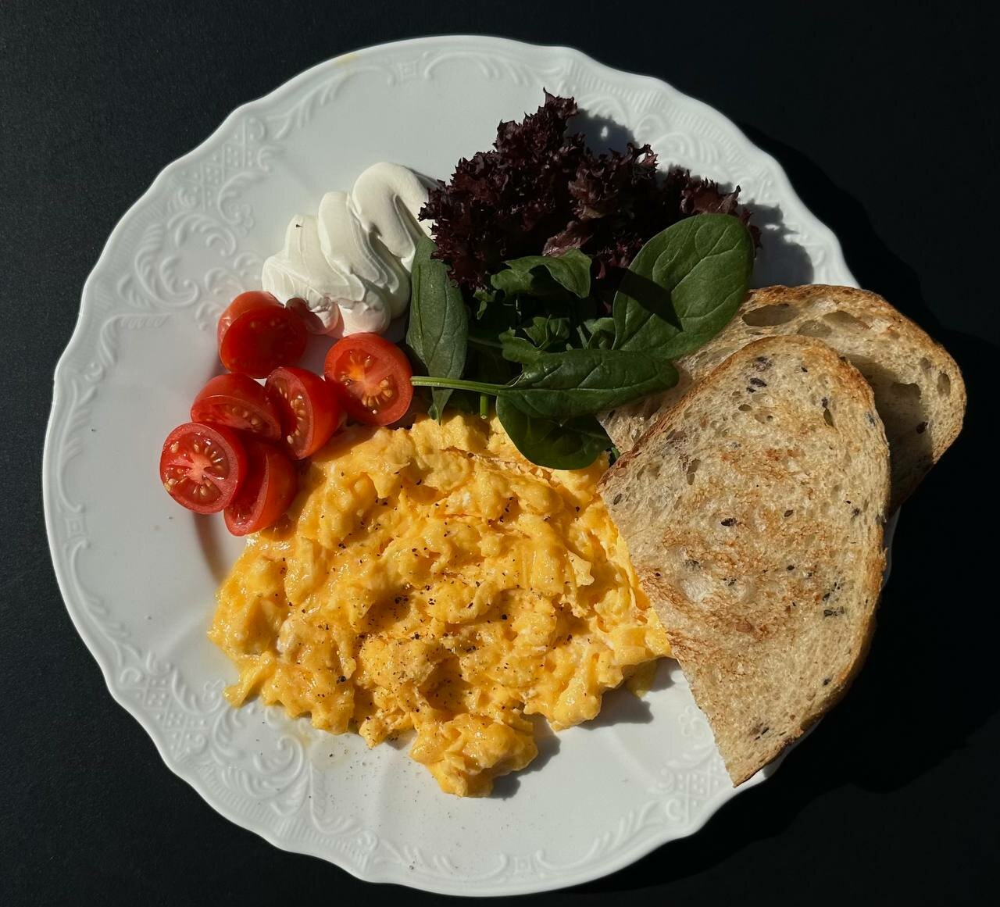

### Глазунья — 350 ₽

menu-033

зелень,черри,творожный сыр,хлеб
+ лосось - 400р
+ креветки - 390р
+ бекон - 160р
+ сосиска - 140р
+ авокадо 1/2 - 200р
+ грибы - 120р
+ фасоль - 120р
+ три сыра - 120р
+ зелень - 170р

Фото: food/food-021.jpg (visual_match)

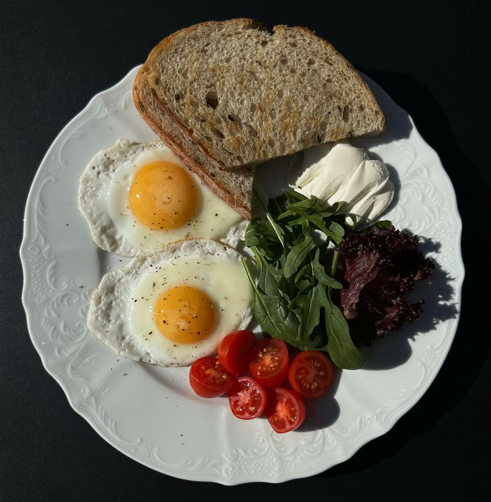

### Омлет — 350 ₽

menu-034

зелень,черри,творожный сыр,хлеб
+ лосось - 400р
+ креветки - 390р
+ бекон - 160р
+ сосиска - 140р
+ авокадо 1/2 - 200р
+ грибы - 120р
+ фасоль - 120р
+ три сыра - 120р
+ зелень - 170р

Фото: food/food-023.jpg (visual_match)

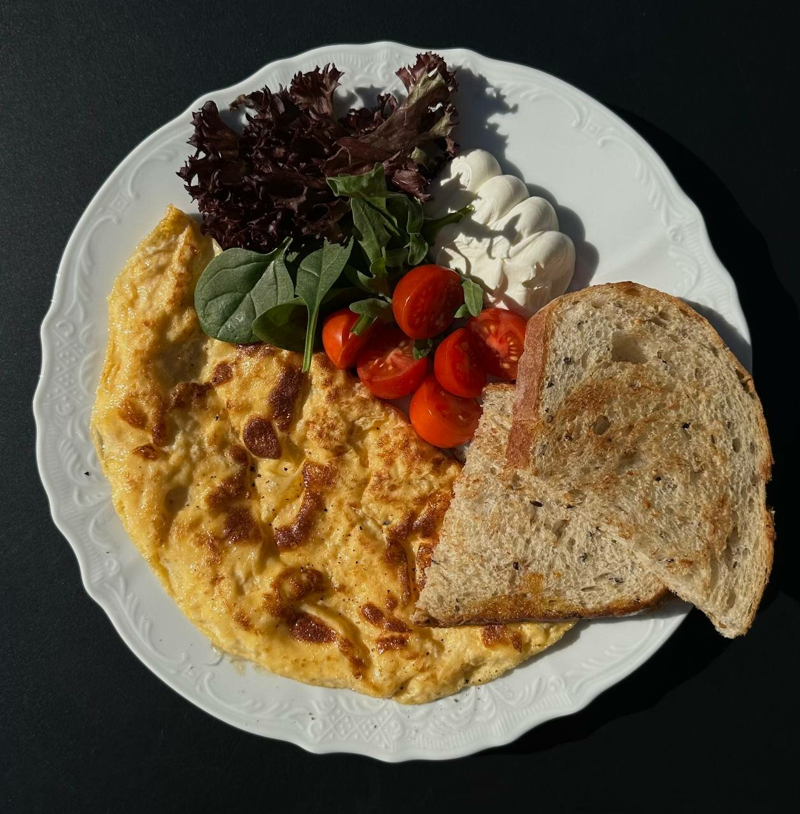

## Холодные напитки

### Айс кофе — 350 ₽

menu-035

Однозначное фото не найдено.

Неоднозначные кандидаты: food/food-015.jpg

### Айс ти — 350 ₽

menu-036

Однозначное фото не найдено.

Неоднозначные кандидаты: food/food-012.jpg

### Эспрессо-тоник — 350 ₽

menu-037

+ кордиал лайм - 50 р

Однозначное фото не найдено.

Неоднозначные кандидаты: food/food-015.jpg

### Матча-тоник — 350 ₽

menu-038

Однозначное фото не найдено.

### Бамбл — 320 ₽

menu-039

Однозначное фото не найдено.

### Фреш апельсин — 330 ₽

menu-040

Порция: 0,2 мл

Однозначное фото не найдено.

### Лимонад — 270 ₽

menu-041

грейпфрут-розмарин, клубника-тархун, апельсин-тоник

Однозначное фото не найдено.

Неоднозначные кандидаты: food/food-012.jpg

### Lapochka — 320 ₽

menu-042

Однозначное фото не найдено.

### Coca-Cola — 250 ₽

menu-043

Однозначное фото не найдено.

## Горячие напитки

### Эспрессо — 220 ₽

menu-044

Однозначное фото не найдено.

### Американо — 220 ₽

menu-045

Однозначное фото не найдено.

### Фильтр — 230 ₽

menu-046

Порция: 0,2 мл

Однозначное фото не найдено.

### Капучино — 260 ₽

menu-047

Порция: 0,2 мл

Однозначное фото не найдено.

Неоднозначные кандидаты: food/food-013.jpg

### Латте — 330 ₽

menu-048

Порция: 0,3 мл

Однозначное фото не найдено.

Неоднозначные кандидаты: food/food-013.jpg, food/food-016.jpg

### Флэт уайт — 290 ₽

menu-049

Однозначное фото не найдено.

Неоднозначные кандидаты: food/food-013.jpg

### Раф — 320 ₽

menu-050

Порция: 0,2 мл

Однозначное фото не найдено.

Неоднозначные кандидаты: food/food-016.jpg

### Мокко — 320 ₽

menu-051

Порция: 0,2 мл

Однозначное фото не найдено.

Неоднозначные кандидаты: food/food-018.jpg

### Глясе — 390 ₽

menu-052

Однозначное фото не найдено.

### Матча — 260 ₽

menu-053

Порция: 0,2 мл

Однозначное фото не найдено.

Неоднозначные кандидаты: food/food-020.jpg, menu/menu-photo-02.jpg

### Матча-раф — 330 ₽

menu-054

Порция: 0,2 мл

Однозначное фото не найдено.

Неоднозначные кандидаты: food/food-020.jpg, menu/menu-photo-02.jpg

### Шот эспрессо — 130 ₽

menu-055

Однозначное фото не найдено.

### Фильтр — 230 ₽

menu-056

Порция: 0,3 мл

Однозначное фото не найдено.

### Капучино — 260 ₽

menu-057

Порция: 0,2 мл

Однозначное фото не найдено.

Неоднозначные кандидаты: food/food-013.jpg

### Латте — 390 ₽

menu-058

Порция: 0,4 мл

Однозначное фото не найдено.

Неоднозначные кандидаты: food/food-013.jpg, food/food-016.jpg

### Раф — 320 ₽

menu-059

Порция: 0,3 мл

Однозначное фото не найдено.

Неоднозначные кандидаты: food/food-016.jpg

### Мокко — 320 ₽

menu-060

Порция: 0,3 мл

Однозначное фото не найдено.

Неоднозначные кандидаты: food/food-018.jpg

### Матча — 260 ₽

menu-061

Порция: 0,3 мл

Однозначное фото не найдено.

Неоднозначные кандидаты: food/food-020.jpg, menu/menu-photo-02.jpg

### Матча-раф — 330 ₽

menu-062

Порция: 0,3 мл

Однозначное фото не найдено.

Неоднозначные кандидаты: food/food-020.jpg, menu/menu-photo-02.jpg

### Какао — 300 ₽

menu-063

Однозначное фото не найдено.

Неоднозначные кандидаты: food/food-018.jpg

## Боулы

### Боул Креветка — 800 ₽

menu-064

черный рис, креветки, брокколи, цукини, яйцо, зеленый соус

Фото: food/food-003.jpg (visual_match)

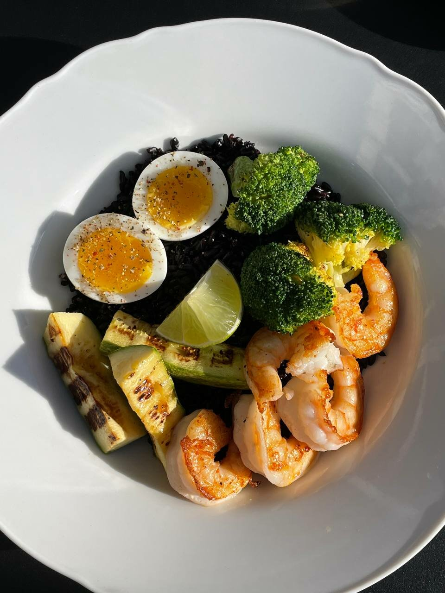

### Боул Утренний — 850 ₽

menu-065

киноа, лосось, авокадо, 2 яйца пашот, зелень, голландез

Однозначное фото не найдено.

### Индийская курочка — 570 ₽

menu-066

рис белый, курица, специи, кинза  
+ салат:
   томаты, огурцы,сметана - 220₽

Фото: food/food-046.jpg (visual_match)

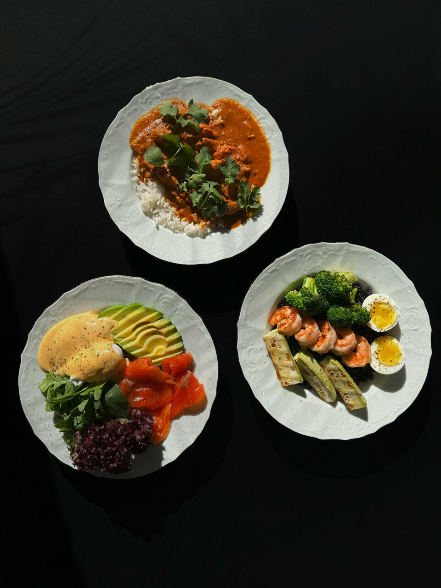
